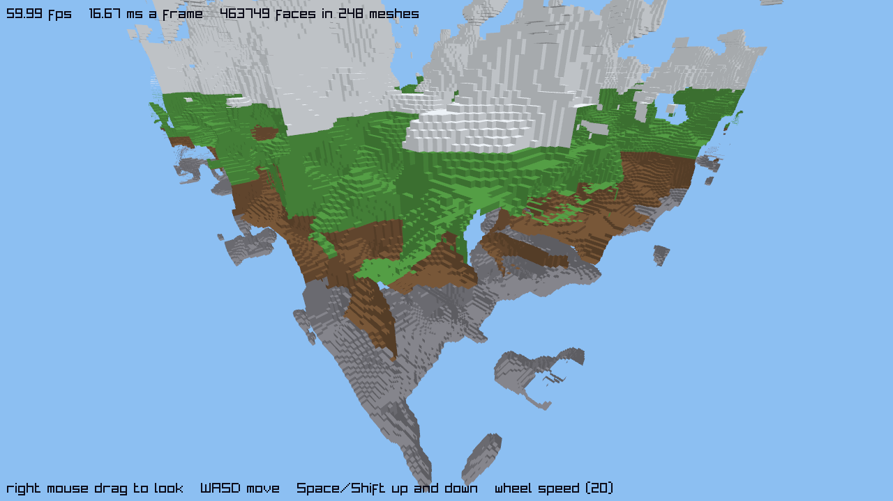

# Voxel viewer: measured times

Measured on 2026-10-11. The viewer is `voxels.kes` (with `world.kes` and `fly.kes`): a `par for` builds every chunk's `MeshData`, one loop turns each into a GPU `Mesh`, and every frame draws all the meshes. The spec's success line is "the voxel viewer shows the 8×4×8-chunk world (463,749 faces) at 60 fps on the development machine."

**Short answer.** At `WIDTH = 8` (463,749 faces, 248 meshes) the world builds in about 73-78 ms and uploads in about 53-59 ms, and **the frame holds 60 fps**. But **every one of these runs was held at 60 fps by the machine** (a 16.67 ms frame on a hidden window, which is normally not capped; see "The 60 fps cap" below), so the frame time and fps in the tables are the display's, not the program's. What the program itself uses is the CPU `draw` time: 0.2-0.3 ms at `WIDTH = 8` and about 0.8 ms at `WIDTH = 16`. I looked for where the real limit is by making the world bigger: **the frame is still held at 60 fps up to `WIDTH = 24` (4.2 million faces) and passes 16.67 ms only at `WIDTH = 32` (7.3 million faces, 16 times the spec's world), where it is 16.95 ms (59 fps).** From about `WIDTH` 24 the program waits inside its draw calls, which points at the graphics driver and the GPU, not at Kestrel's code.



The picture is a hidden-window screenshot at frame 300, taken by a scratch copy of the viewer that calls `window.screenshot` (the overlay shows the last report's numbers): four height bands (stone, dirt, grass, snow), each face shaded by the way it faces, nothing inside-out.

## What the numbers are

- **build** is the time of the `par for` that makes every chunk's `MeshData`, in ms, once at start (from `window.ticks_usec()`).
- **upload** is the time of the loop that calls `draw3d.make_mesh` for every chunk, in ms, once at start. It includes copying each chunk's vertices, colours and indices to the GPU. It runs on the main thread, one chunk after another.
- **draw** is the time the program spends in `draw.clear`, `draw3d.camera` and the `draw3d.mesh` calls of one frame, in ms. It is the CPU time of *submitting* the draws, **not GPU time**: the GPU runs after the call returns, unless the driver makes the call wait.
- **frame** is the whole loop iteration, including the wait inside `window.frame()` (which shows the frame, waits for vsync and reads input).
- **fps** is frames divided by seconds.

The per-second columns follow `demos/particles/results.md`: each cell is the median of the per-second averages the viewer prints (one line a second), over runs of about 11 seconds with the first line dropped, with the range of those averages in brackets. **build** and **upload** come once a run, so their cell is the median over the runs, with the range of the runs in brackets.

## Setup

- AMD Ryzen 7 5800X (8 cores, 16 threads), NVIDIA GeForce RTX 3070 (driver 591.86), Windows 11, a 60 Hz display. `par for` used all 16 threads unless `KESTREL_THREADS` says otherwise.
- A 1280×720 window, vsync on. **Every run used a hidden window** (`KESTREL_HIDDEN=1`), because the user must not see one.
- Both `kestrel run --release` (the JIT) and a `kestrel build --release` exe. The exe is 992,768 bytes (969.5 KiB), the same at every `WIDTH`.
- Measured copies of `voxels.kes` with only `WIDTH` changed (8 or 16). The camera stays at its start (a hidden window gets no input), so every run draws the same view.
- `bench/particles/measure.py` ran the commands in interleaved rounds (JIT and exe of each `WIDTH` in turn) and killed each process it started after 11 seconds. 4 rounds for the frame columns; the start-up columns pool those with a 10-round batch (14 runs each).
- The machine is noisy: a desktop with other programs open, and the GPU showed 20-37% busy with nothing of mine running. Read differences under about 10% as noise.

## The 60 fps cap

A hidden window is normally not held to the display's rate on this machine (see the end of `bench/particles/results.md`, which also records an earlier spell when it was). **During all of this session every hidden run was held at 60 fps**, whatever the world size, until the work per frame went past 16.67 ms (see the headroom table). So:

- `measure.py --retry-capped` did not help: every run of the main tables was repeated once (4 repeats a configuration, all of them capped again), and an earlier try with 4 repeats each at `WIDTH` 8 and 16 stayed capped too. Of the roughly 120 runs at `WIDTH` 8 and 16, all but two had a median frame of 16.6-16.7 ms (the two were `WIDTH` 16 runs at 16.97 and 17.02 ms, in a batch with a slow start-up).
- **The frame and fps cells for `WIDTH` 8, 16, 20 and 24 below are capped: the median frame is the display's 16.67 ms.** At `WIDTH` 8 and 16 every per-second value in the "`WIDTH` 8 and 16" table below is 16.60-16.74 ms; at 20 and 24 the median is, but some seconds were slower (up to 23.41 and 30.52 ms). The cells say the program finished its median frame in time, not how much time it had left. The CPU `draw` time and the stress runs below are what say how much.
- A visible window would also show at most 60 fps (vsync).

## Results: `WIDTH` 8 and 16

| WIDTH | Run | meshes | faces | build ms | upload ms | draw ms | frame ms | fps |
|---:|---|---:|---:|---:|---:|---:|---:|---:|
| 8 | JIT | 248 | 463,749 | 77.5 (64.8-110.9) | 59.2 (50.0-120.3) | 0.26 (0.19-1.96) | 16.67 (16.61-16.73), capped | 60.0 (59.8-60.2), capped |
| 8 | exe | 248 | 463,749 | 72.7 (64.7-126.4) | 52.8 (47.7-103.0) | 0.23 (0.19-1.85) | 16.67 (16.64-16.70), capped | 60.0 (59.9-60.1), capped |
| 16 | JIT | 1,000 | 1,908,007 | 292.6 (257.9-345.8) | 205.7 (190.3-290.0) | 0.82 (0.73-0.91) | 16.67 (16.62-16.70), capped | 60.0 (59.9-60.2), capped |
| 16 | exe | 1,000 | 1,908,007 | 296.6 (264.8-684.0) | 217.7 (193.0-747.5) | 0.76 (0.67-5.22) | 16.67 (16.60-16.74), capped | 60.0 (59.8-60.2), capped |

The frame cells are over 32-36 per-second values a row; the start-up cells over 14 runs. 8 of the 256 chunks at `WIDTH` 8 (24 of 1,024 at 16) have no faces and get no mesh, which is why meshes is fewer than chunks. At `WIDTH` 8, 3 of the 8 are all air and 5 are solid all through, buried in the bottom layer (a scratch program counted the solid flags of each: 0 or all 39,304). The faces count is exact (463,749 at `WIDTH` 8, the benchmark's).

- **JIT and exe are the same speed** within the noise, as expected: both run the same machine code.
- **Build:** 73-78 ms at `WIDTH` 8 for 256 chunks (runs 65-126 ms), 293-297 ms at 16 for 1,024 (runs 258-684 ms): 4 times the chunks, about 4 times the time. These are the medians of the JIT and exe rows; the ranges are in the table.
- **Upload:** 53-59 ms at `WIDTH` 8 (runs 48-120 ms), 206-218 ms at 16 (runs 190-748 ms). It is about 27-32 ns for each vertex at both sizes (1.85 million vertices at `WIDTH` 8, 7.63 million at 16).
- **Outliers** are the machine, not the viewer: single runs showed a draw of 1.4 to 5 ms for several seconds, and one exe run at `WIDTH` 16 a build of 684 ms and an upload of 747 ms (the medians ignore them).
- **Start-up** (build plus upload) is about 125 ms at `WIDTH` 8 and about 500 ms at `WIDTH` 16.
- **Memory:** the process's peak working set was 269 MiB at `WIDTH` 8 and 875 MiB at 16 (a single run of each, polled every 10 ms). Most of it is the build arena, which holds every chunk's lists until the upload is done.
  - **The process keeps that memory after the upload.** The `arena { }` frees it for the program (the program arena stays at 64 KiB), but the runtime keeps freed blocks in a per-thread spare cache for later arenas instead of returning them to Windows (`runtime/src/blocks.rs`, up to 256 MiB a thread). The `par for` threads' arenas are handed to the `arena { }` (`runtime/src/par.rs`), so all of its blocks are freed, and cached, on the main thread. So the working set stays near its peak at `WIDTH` 8: an earlier run measured 268 MiB at the end, for a world whose GPU data is 35 MB.
  - **A headless check** (a release exe of the committed viewer, no window and no graphics driver, one run, sampled every 20 ms): after the build the working set was 172 MiB for the whole run, with the program arena at 64 KiB. That is close to the 184 MiB of blocks the build allocates (the program arena of a copy without the `arena { }`). The rest of the 268 MiB is presumably the graphics context and driver; I did not measure it. The same check at `WIDTH` 16 held 249 MiB, just under the 256 MiB limit. That these 172 and 249 MiB are the spare cache is read from the code and fits the numbers; I did not instrument the cache.

### The world's meshes

- `WIDTH` 8: 256 chunks, 248 meshes, 1,854,996 vertices, 463,749 faces. The largest chunk has **18,508 vertices** (4,627 faces; chunk 6, 2, 3). `WIDTH` 16: 1,024 chunks, 1,000 meshes, 7,632,028 vertices, largest chunk 18,928 vertices. **No chunk goes over 65,536 vertices, so no mesh is split into parts** (the window crate's limit for one part of a mesh). A chunk would have to be 3.5 times as full.

### One thread against all threads

`KESTREL_THREADS` at `WIDTH` 8 (exe, 8 runs each, build ms, median and range; upload for comparison):

| Threads | build ms | upload ms |
|---:|---:|---:|
| 1 | 493.2 (484.5-512.2) | 45.2 (43.8-48.4) |
| 4 | 138.2 (134.7-143.4) | 46.6 (46.0-54.1) |
| 16 (all) | 66.1 (64.6-68.5) | 48.2 (46.5-52.5) |

The one-thread build is **7.5 times** as long as the 16-thread one on this 8-core, 16-thread CPU (the same ratio at `WIDTH` 16: 1,956 ms against 260 ms). 4 threads give 3.6 times. As in the particles demo, that is not 16 times; eight of the threads are SMT siblings sharing a core (I did not test that here). The upload does not change with the thread count (it is one thread calling the graphics driver). On one thread a chunk takes about 1.9 ms to build, at both sizes.

## Where the time goes in the frame

### Headroom: making the world bigger

The capped frame hides the program's own time, so I raised `WIDTH` until the frame passed 16.67 ms. A plain `WIDTH` of 24 would not fit the memory I allowed myself (the build arena holds every chunk's lists: about 1.8 GiB at 24, by extending the 269 and 875 MiB peaks at `WIDTH` 8 and 16, when 2.2-4.2 GB of memory was free). So **the rows from 20 up are a scratch variant** that builds the world one slab of chunks at a time, with an `arena { }` of its own for each slab (the same `chunk_mesh` and `make_mesh` calls, so the same meshes and the same frame loop; only the start-up is arranged differently, which is why I give no build or upload times for these rows). All exe runs, 4 rounds of 16 seconds, 46-51 per-second values a row.

| WIDTH | meshes | faces | draw ms | frame ms | fps |
|---:|---:|---:|---:|---:|---:|
| 8 | 248 | 463,749 | 0.23 | 16.67, capped | 60.0, capped |
| 16 | 1,000 | 1,908,007 | 0.76 | 16.67, capped | 60.0, capped |
| 20 | 1,557 | 2,968,102 | 1.18 (1.06-17.28) | 16.67 (16.62-23.41), capped | 60.0 (42.7-60.2), capped |
| 24 | 2,245 | 4,210,488 | 9.59 (8.20-26.73) | 16.67 (16.60-30.52), capped | 60.0 (32.8-60.2), capped |
| 32 | 3,983 | 7,339,599 | 14.21 (13.16-66.29) | **16.95 (16.40-66.48)** | **59.0 (15.0-61.0)** |

- **The frame is held at 60 fps up to `WIDTH` 24, and only just passes 16.67 ms at 32**: 16.95 ms median, and per run 16.69, 16.68, 17.24 and 19.20 ms. So **the viewer stops reaching 60 fps somewhere between `WIDTH` 24 and 32** (4.2 and 7.3 million faces); I did not run in between. `WIDTH` 32 is 16 times the spec's world.
- **The draw time is what changes first.** It is 1.2 ms at 3.0 million faces and 9.6 ms at 4.2 million (8 times as long for 1.4 times the faces); at 7.3 million it is 14.2 ms of the 16.95. With 4,000 `draw3d.mesh` calls, that is not the cost of the calls: in the stress runs below, 3,968 calls cost 1.9 ms. The rest is the program **waiting inside the draw calls for the driver and the GPU**. So I take the limit to be the GPU and its driver. The waiting starts between 3 and 4 million faces and does not grow in step with the face count, so there is no steady cost for each million faces to quote. This is an inference from the waiting, not a GPU timing.
- The first seconds of the big worlds are slower (`WIDTH` 32: 66, 45, 31, then 14-17 ms a frame), maybe because the driver moves the buffers into video memory on their first use, or the GPU clock ramps up; I did not find out which. The medians are over every value after the first line.

### Stress: drawing the `WIDTH` 8 world several times

To see the cost of more faces without the memory (and to see a frame past the cap), a copy of the viewer's frame loop drew every mesh K times a frame: the same faces at the same place, which is not what a real bigger world is. Exe, 3 rounds of 13 seconds, 30-33 values a row:

| World | K | draw calls a frame | faces drawn a frame | draw ms | frame ms | fps |
|---|---:|---:|---:|---:|---:|---:|
| `WIDTH` 8 | 2 | 496 | 0.93 M | 0.33 | 16.67, capped | 60.0, capped |
| `WIDTH` 8 | 4 | 992 | 1.9 M | 0.59 | 16.67, capped | 60.0, capped |
| `WIDTH` 8 | 8 | 1,984 | 3.7 M | 1.13 | 16.67, capped | 60.0, capped |
| `WIDTH` 8 | 16 | 3,968 | 7.4 M | 1.92 | 16.67, capped | 60.0, capped |
| `WIDTH` 8 | 32 | 7,936 | 14.8 M | 3.27 | **19.95 (19.51-20.99)** | **50.1** |
| `WIDTH` 16 | 2 | 2,000 | 3.8 M | 1.35 | 16.67, capped | 60.0, capped |
| `WIDTH` 16 | 4 | 4,000 | 7.6 M | 2.12 | 16.67 (16.50-17.32), capped | 60.0, capped |

- **Submitting a draw call costs about 0.4-0.9 microseconds** (`WIDTH` 8 once: 0.23 ms for 248 calls; K = 32: 3.27 ms for 7,936 calls). The CPU side of drawing is cheap at all of these sizes.
- **With the same meshes drawn again, 60 fps holds up to 7.4 million faces a frame and the frame passes 16.67 ms at 14.8 million (19.95 ms), with the draw calls still only 3.3 ms.** There, I take it, the frame is spent waiting for the GPU while the program is idle. The real bigger worlds go over at about half as many faces (7.3 million). I don't know why they cost more a face. Candidates: a real world has 7.3 million faces of different data (about 560 MB of vertex data and indices, against 35 MB for the `WIDTH` 8 world, which the stress copy reads again and again), and more of it is in view. I did not test either.
- That the `WIDTH` 8 world can be drawn 16 times over and still hold 60 fps is the basis for "room to spare" below. It is an inference from stress runs, not a measured uncapped frame of the real viewer.

### Does `WIDTH` 8 reach the spec's 60 fps?

**Yes.** Every `WIDTH` 8 run (JIT and exe, about 70 runs in all) held 60 fps (59.1-60.9 in the per-second values), at a draw time of 0.2-0.3 ms. That is the display's rate, not the program's: the machine held hidden windows at 60 fps the whole time, so I cannot give the frame time the program would reach without the cap. Evidence for how much room there is:

- The CPU draw at `WIDTH` 8 is 0.25 ms of a 16.67 ms frame.
- The same world drawn 16 times a frame (7.4 million faces) still holds 60 fps; the real bigger worlds, with 4.2 million faces (`WIDTH` 24) hold it and 7.3 million barely fail it. So the GPU time for the 463,749 faces of `WIDTH` 8 is not measured, but it is far under a frame.
- The program's own part of a frame (reading input, `fly`, the overlay text, `window.frame()`) is not separated out here.

A visible window would show at most 60 fps (vsync, which `window.open` always turns on), so 60 is also the most the spec could ask for. I did not run a visible window.

## Where the start-up time goes: the upload

At `WIDTH` 8 the upload takes 53-59 ms (medians; runs 48-120 ms) and the build 73-78 ms (runs 65-126 ms), so the upload is about 40% of the start-up. Earlier runs of the viewer on this machine, before these measurements, showed an upload of 290-320 ms, several times what plan 2's measure of `make_mesh` predicts (a 70,000-vertex mesh in about 2.1 ms, so about 55 ms for 1.85 million vertices). **That slow upload did not come back in about 50 runs at `WIDTH` 8 (46-120 ms), and the upload agrees with plan 2's figure.** I could make it slow again, by a lot, only by loading the CPU (below).

A scratch program timed each `make_mesh` call with `window.ticks_usec()` after the same build, twice (the second pass uploads the same data again). Three runs of 248 meshes each; the per-vertex figures are from the first run:

| What | Result |
|---|---|
| all 248 calls, pass 1 (right after the `par for`) | 52.7-54.3 ms, **28.7 ns a vertex** |
| all 248 calls, pass 2 (the same data again) | 49.5-55.7 ms, 26.5 ns a vertex |
| the first call of a run | 321-418 µs for 5,824 vertices (133-144 µs when repeated). The first 10 meshes take 38-48 ns a vertex against 28-29 for the rest: a warm-up of about 1 ms |
| time against vertices, least squares | 28 µs plus 24.9 ns a vertex (r² 0.77): the vertex count sets the time, not the call |
| a 1-quad mesh (4 vertices) | 10-12 µs a call, so **per-call overhead is about 2.7 ms of the 53** (248 calls) |
| flat grids of quads, with colours | 118 µs for 4,096 vertices (29 ns a vertex), 346 µs for 16,384 (21 ns), 1,184 µs for 65,536 (18 ns) |
| the same grids with no colour list | 59 µs, 194 µs and 642 µs (14, 12 and 9.8 ns a vertex) |

Colours take 44-50% of the time on those grids. `make_mesh` turns each `Color` (four floats) into four bytes with `channel` (clamp, multiply by 255, `round`). A copy of that code by itself (`rustc -O`) takes **6.0 ns a vertex**, which is about 11 ms of the 53 (21%) for 1.85 million vertices; narrowing the indices from `int` to `u16` takes 0.2 ns a vertex (under 1 ms). What is left, **about 39 ms (73%), is `UploadMesh`**: raylib creating a vertex array and a buffer each for the positions, the colours and the indices (35 MB for the whole world, which is under 1 GB/s). That 39 ms is by subtraction. I did not look inside `UploadMesh`, so I can't say how it splits between raylib's calls and the NVIDIA driver; the particles bench (`bench/particles/results.md`) found a second driver thread busy during uploads on this machine, which would fit, but I have not shown it here.

**The upload gets slow under load.** With a CPU burner on 8 of the 16 threads the upload was 56-68 ms (6 runs; the build slowed from 66 to 99-110 ms). With all 16 busy it was 1,451 and 4,582 ms (2 of 4 runs; the other 2 printed nothing in 11 seconds), and with 32 busy processes 85, 1,777 and 1,422 ms (3 of 4 runs), with builds of 190-325 ms. My guess is that the main thread and the driver's own thread both wait for time slices. So the 290-320 ms was most likely a run while something else was working the CPU; I can't say what. It is not the upload's own cost. The `par for` pool does not slow the upload: with `KESTREL_THREADS=1` it took 45.2 ms against 48.2 ms with all threads.

**A fix idea** (not tried; `kestrel/window` is unchanged):

1. A branch-free colour conversion, `(c.clamp(0,1) * 255 + 0.5) as u8`, took 3.0 ns a vertex against 6.1 for `round` in a scratch copy of the Rust (4.3 against 7.4 at 16,000 vertices): about 5.5 ms of the 53. It gave the same bytes for all 16 of the world's colours and for a million random values, and differed on 1 of 768 values chosen at the half-steps, so `to_raylib`'s tests would need a look.
2. The bigger win is the order of the start-up: the 55 ms upload runs after the 70 ms build, and the pool sits idle through it. A `par for` that streams its results to the main thread, which uploads each chunk as it arrives, would hide most of the upload in the build (about 125 ms down to about 75 ms, if the two overlapped completely). The language has no such loop today.

## What would make it faster

At `WIDTH` 8 nothing in the frame needs fixing; the viewer is the display's. For a bigger world the GPU is the limit, so what helps is drawing less: skipping meshes that are behind the camera or outside its view (the viewer draws all of them every frame), and drawing fewer faces further away. The 4,000-call frames of the big worlds cost 14 ms of waiting, and the CPU side of the same number of calls costs 2 ms, so cutting the call count is not the first thing to try.

## What missed or is uncertain

- **No uncapped frame time for the real viewer at `WIDTH` 8, 16, 20 or 24.** The machine held hidden windows at 60 fps throughout (see above). The room at `WIDTH` 8 is an inference from the CPU draw time and the stress runs.
- **`WIDTH` 20, 24 and 32 are a scratch variant** (slab arenas), not the committed viewer, because the committed viewer's arena would take about 1.8 GiB at `WIDTH` 24 and 3.3 GiB at 32 (extended from the 8 and 16 peaks, not measured), more than half of the free memory (2.2-4.2 GB free during the work). The frame loop is the same code. The peak working set of the variants was 745 MiB at `WIDTH` 24 and 1,001 MiB at 32. I did not run the committed viewer at those sizes.
- **The `WIDTH` 32 row is on the edge**: the per-run medians are 16.69, 16.68, 17.24 and 19.20 ms, and 4 runs are not enough to say whether it is 60 fps or 59 fps. I did not run in between (`WIDTH` 28 or 30) to find the exact point.
- **The stress runs are not a real larger world**: they draw the same 35 MB of meshes again and again, and a real world of the same face count held up less well, so they probably understate the GPU cost.
- **Noise.** The GPU was 20-37% busy with other programs, and some runs show outliers (a draw of 1.4-5 ms for several seconds, a start-up ten times slower).
- The upload's split (colours 6 ns a vertex, calls 11 µs, the rest `UploadMesh`) is from a copy of the Rust code and a subtraction, not from instrumenting the window crate. Why the upload was 290-320 ms in earlier runs is a guess (CPU load), tested only by loading the CPU on purpose.

## Reproducing it

From `kestrel/` (Windows, Git Bash or PowerShell; `my_copy.kes` is `demos/voxels/voxels.kes` with `WIDTH` changed, next to copies of `world.kes` and `fly.kes`):

```
cargo build --release -p kestrel-cli
target/release/kestrel build --release my_copy.kes -o my_copy.exe
python bench/particles/measure.py --rounds 4 --retry-capped 1 \
  "jit8=KESTREL_HIDDEN=1 target/release/kestrel.exe run --release my_copy.kes" \
  "exe8=KESTREL_HIDDEN=1 my_copy.exe"
```

`measure.py` prints the medians and ranges (a row's `build ms` and `upload ms` are over the runs, `draw`, `frame` and `fps` over the per-second lines), warns about runs held to 60 fps (a median frame between 16.4 and 17.0 ms) and kills each process it started after 11 seconds. Every command needs `KESTREL_HIDDEN=1`. The viewer prints `voxels world 8 chunks 256 meshes 248 faces 463749 build 66.49 ms upload 51.07 ms` at start, and a line like `voxels 8 meshes 248 faces 463749 draw 0.23 ms frame 16.67 ms fps 60` once a second. For a one-thread build, add `KESTREL_THREADS=1`.
