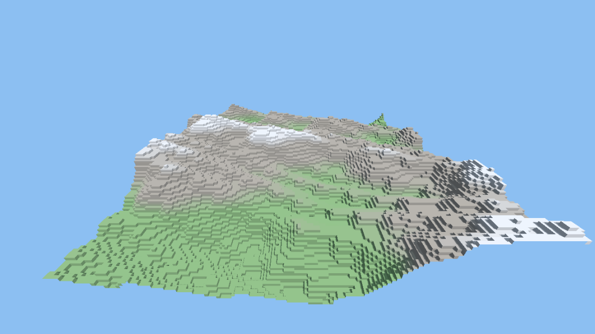

# Kestrel for Godot

This add-on runs Kestrel inside Godot 4 (4.2 or newer; tested on 4.7.2). GDScript loads a `.kes` file and calls its `pub` functions. The file is compiled in memory, and saving it while the game runs swaps in the new version.



The demo above: `demo/voxels.kes` computes every chunk's mesh, and `demo/main.gd` only hands the arrays to Godot.

## Try the demo

```powershell
cd kestrel/godot
./build.ps1        # builds the add-on and copies it into demo/addons/kestrel/bin
```

Open `kestrel/godot/demo` in Godot and press Play. Edit `voxels.kes`, for example `HEIGHT` or the noise scales, and save: the terrain rebuilds.

## Use it in your project

Copy `demo/addons/kestrel` (with `bin/kestrel_godot.dll`) into your project's `addons/` folder, then restart the editor. In GDScript:

```gdscript
var kestrel := Kestrel.new()

func _ready() -> void:
    if kestrel.load("res://voxels.kes"):          # errors print to the Output panel
        var heights: PackedInt32Array = kestrel.run("heights", [0, 0, 1337])

func _process(_delta: float) -> void:
    if kestrel.refresh():                          # true when a saved edit was loaded
        rebuild()
```

- `load(path)` compiles a file (`res://...` or an absolute path), plus the modules it uses. It returns `false` if there are errors.
- `run(name, args)` calls a `pub` function and returns its result, or `null`. It recompiles first if a file changed.
- `refresh()` recompiles if a file changed and returns whether a new version is loaded. If an edit has errors, they're printed and the old version keeps running.
- `functions()` lists the functions `run` can call.

A `.kes` file loaded by Godot is a library: it doesn't need `main()`. It can't `use window`, `use draw` or `use input`, which are for Kestrel programs that open their own window; `load` prints an error and returns `false`.

## Types

| Kestrel | Godot |
|---|---|
| `int`, `i64`, `u8` | `int` |
| `float`, `f64` | `float` |
| `bool` | `bool` |
| `string` | `String` |
| `vec2`, `vec3` | `Vector2`, `Vector3` |
| `[int]`, `list[int]` | `PackedInt32Array` |
| `[i64]` | `PackedInt64Array` |
| `[float]` | `PackedFloat32Array` |
| `[f64]` | `PackedFloat64Array` |
| `[u8]` | `PackedByteArray` |
| `[vec2]` | `PackedVector2Array` |
| `[vec3]` | `PackedVector3Array` |

Functions using other types (structs, enums, optionals) still work inside Kestrel; they just can't be called from Godot directly.

## How it behaves

- **Each call runs on a Kestrel thread with its own memory**, which is freed when the call returns, so nothing builds up between calls.
- **Kestrel's `print` shows up in Godot's Output panel.**
- **A runtime error** (a bad index, overflow) prints as a Godot error naming the line and the file (``... on line 24 of world.kes (in `crash`)``), and `run` returns `null`. The editor keeps running, and the next call works.
- **Rebuilding the add-on needs Godot closed:** Windows locks the DLL while it's loaded. Editing `.kes` files never needs a rebuild.

## Test

```powershell
godot --headless --path demo --import
godot --headless --path demo --script res://tests/test_bridge.gd   # exit code = failed checks
```
